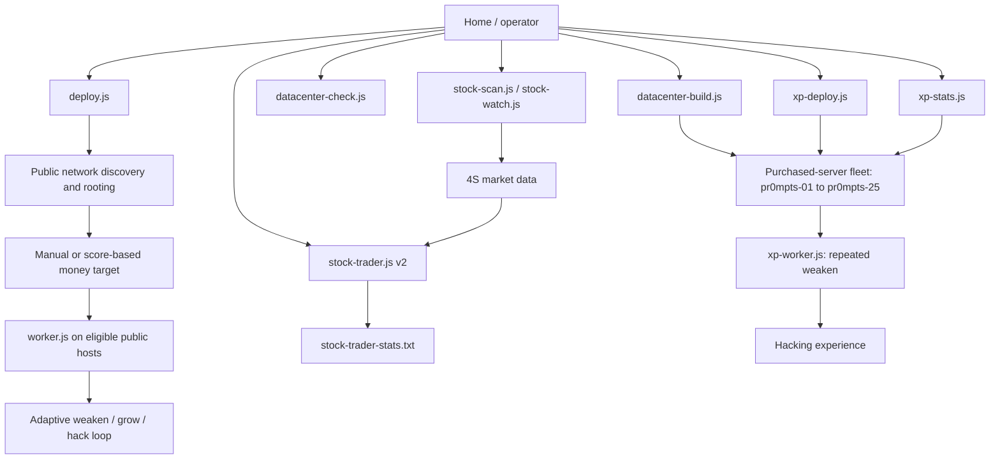
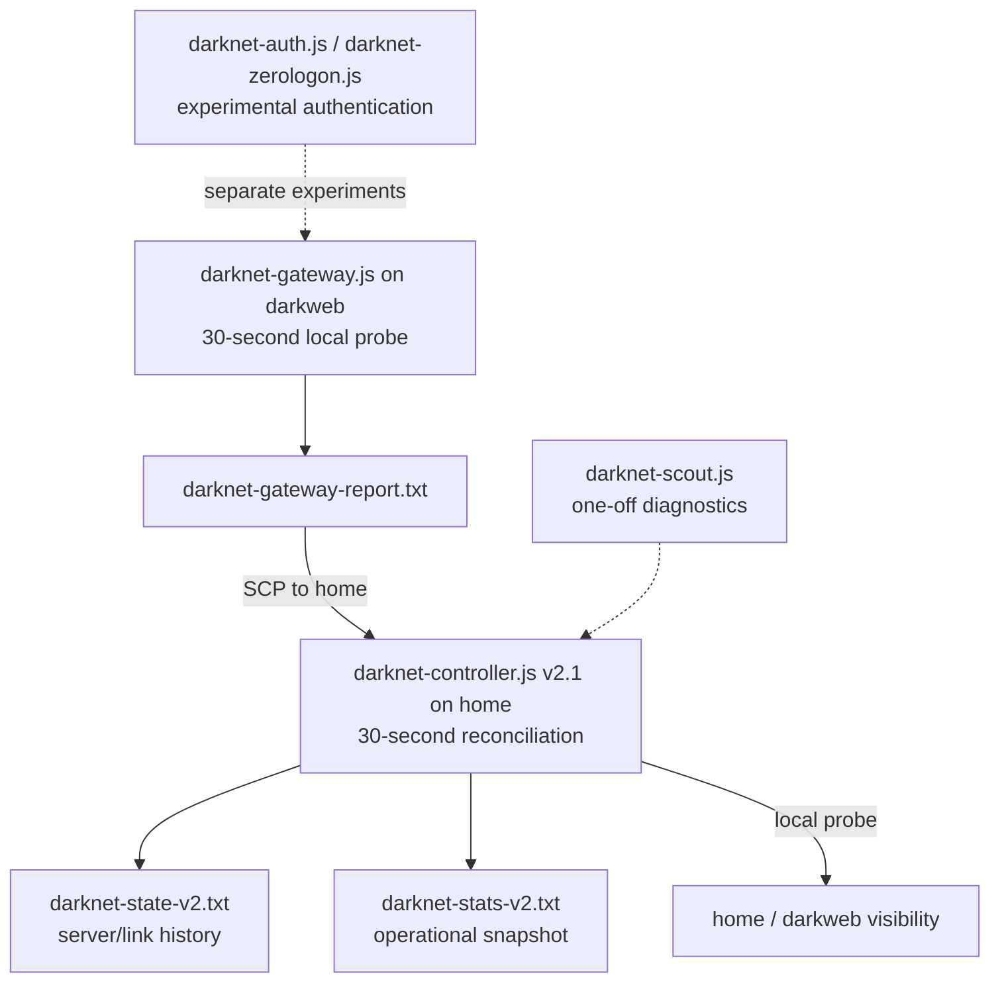

# Bitburner Automation Architecture

> Evidence-based description of the project's automation architecture. Historical figures from Session 17 are distinguished from the newer verified Run 6 datacenter checkpoint. Live game state and exact repository contents must be checked independently.

---

# Current System

The project uses **three production automation systems**: a distributed hacking network, a long-only stock trader, and a dedicated purchased-server hacking-XP datacenter. A fourth, experimental Darknet reconnaissance subsystem is documented below. Each has a separate purpose and should be managed without disrupting the others.

`deploy.js` is an on-demand recovery and orchestration command, not a permanently running service. It discovers and roots the public network, selects a money target, and starts `worker.js` on eligible public hosts. The revised deployment strategy excludes purchased servers so they can be reserved for dedicated workloads.

`stock-trader.js` independently trades 4S forecast signals. The purchased-server fleet runs `xp-worker.js` processes that repeatedly weaken a rooted target to generate hacking experience. `xp-deploy.js` provisions these XP workers; it is also an on-demand command, not a permanently running service.

**Historical Session 17 money-network checkpoint:** 43 worker hosts, 1,338 worker threads, target `4sigma`. These are not live values.

**Later verified Run 6 XP-datacenter checkpoint:** 25 purchased servers, 25 XP worker processes, 25,000 XP threads, approximately 47.50 TB RAM used and 26.17 PB RAM available. At the recorded `xp-stats.js` reading, hacking was level 2,073 with 2.693b accumulated hacking XP. These are checkpoint measurements, not live telemetry.

---

# Hacking Automation

## Discovery, rooting, and deployment

`Scripts/deploy.js` performs a breadth-first scan from `home`. For each discovered non-Home public server, it invokes available port-opening programs (`BruteSSH.exe`, `FTPCrack.exe`, `relaySMTP.exe`, `HTTPWorm.exe`, and `SQLInject.exe`) and calls `nuke()` when enough ports have been opened.

The command accepts an optional target. Without one, it chooses a rooted, hackable money server using maximum money × hack chance ÷ hack time. It stops only its prior `worker.js` instance on eligible hosts, copies the worker, calculates free RAM after unrelated scripts, and starts as many worker threads as fit. The revised design excludes servers returned by `ns.cloud.getServerNames()` from the money-worker deployment. Confirm the revised file is the version committed to the repository before relying on this separation.

`Scripts/scan.js` reports neighbours of the current host, including required level/ports, root and backdoor status, RAM, and money. `Scripts/route.js` performs a breadth-first route search from Home and prints connection commands and a final `backdoor` reminder.

## Worker behaviour and recovery

`Scripts/worker.js` is an adaptive loop, not a timed HWGW batch system. It weakens when security is more than five above minimum, grows when money is below 75% of maximum, and otherwise hacks. This remains the normal public-network production workload.

`Scripts/drain.js` and `Scripts/recover.js` are separate one-off tools for server-draining achievements and subsequent recovery. `Scripts/hack.js`, `Scripts/grow.js`, and `Scripts/weaken.js` are single-action infinite loops; `Scripts/analyzeServers.js` prints suitability metrics for a fixed five-server list; and `Scripts/list-augs.js` prints owned augmentations from reset information.

## Operational limits

- `deploy.js` does not deploy to Home or install backdoors.
- The money-worker fleet uses available RAM on eligible public hosts, preserving RAM already used by unrelated processes.
- Target selection is heuristic; it does not use the Formulas API.
- No advanced timed HWGW batching is implemented.
- Purchased-server exclusion is essential to prevent money-worker deployment from interfering with XP workers.

---

# Purchased-Server Datacenter and XP Automation

## Purpose and verified capacity

The dedicated datacenter converts excess funds into computing capacity for hacking progression without replacing the public-network income system.

| Property | Verified Run 6 checkpoint |
|---|---|
| Purchased servers | 25 / 25 |
| Server names | `pr0mpts-01` through `pr0mpts-25` |
| RAM per server | 1,048,576 GB (approximately 1.05 PB) |
| Combined RAM | 26,214,400 GB (approximately 26.21 PB) |
| Purchase cost per server | Approximately $57.672b |
| Total purchase cost | Approximately $1.442t |
| XP worker processes | 25 |
| Threads per XP worker | 1,000 |
| Total XP threads | 25,000 |
| Datacenter RAM used | Approximately 47.50 TB |
| Datacenter RAM available | Approximately 26.17 PB |

The purchase prices and capacity limits are specific to the tested game state; they should not be assumed universal across game versions or BitNodes. RAM usage includes all processes on purchased servers, not necessarily XP workers alone.

## Datacenter scripts

| Script | Responsibility | Operational behaviour |
|---|---|---|
| `datacenter-check.js` | Inspect purchased-server limit, maximum RAM, costs and utilisation | Read-only diagnostic |
| `datacenter-build.js` | Purchase maximum-RAM servers using the Cloud API | One-off infrastructure provisioning; incurs cost |
| `xp-worker.js` | Continuously call `ns.weaken(target)` | Long-running XP workload |
| `xp-deploy.js` | Copy and start XP workers across purchased servers | On-demand deployment; preserves matching workers and skips conflicting configurations |
| `xp-stats.js` | Count XP processes/threads and report RAM, hacking level and XP | Read-only diagnostic |

The tested Bitburner 3.0 purchased-server interface uses `ns.cloud.getServerLimit()`, `ns.cloud.getRamLimit()`, `ns.cloud.getServerNames()`, `ns.cloud.getServerCost(ram)` and `ns.cloud.purchaseServer(name, ram)`. Scripts using older purchased-server API calls may require updating.

## Deployment and isolation

`xp-worker.js` accepts a target argument, defaulting to `n00dles`, checks that the target exists and is rooted, and repeatedly calls `ns.weaken(target)`. It does not perform money-target selection or hack/grow operations.

The initial `xp-deploy.js` deployment uses `run xp-deploy.js n00dles 1000 25` from Home. It enumerates purchased servers, checks for existing XP workers, copies the script, and starts the requested threads when sufficient RAM is available. A matching worker is retained; an existing worker with different target or thread settings is skipped rather than replaced. **Changing the requested thread count alone does not scale an already-running fleet.** Scaling requires a deliberate, safely managed replacement procedure.

The money fleet and XP fleet must remain isolated. In particular:

- Do not use a broad `killall` or terminate unrelated scripts to adjust XP deployment.
- Verify the target is rooted before deploying workers.
- Check worker counts, thread totals and available RAM after deployment.
- Preserve stock trading and other existing workloads regardless of which host they are running on.
- Scale cautiously: the game-performance impact and XP-per-thread efficiency have not yet been measured.

## Performance evidence and research gaps

The verified `xp-stats.js` checkpoint reported 25,000 active threads and 2.693b hacking XP at level 2,073. The operator subsequently observed noticeably faster hacking progression. This is encouraging observational evidence, **not** a controlled XP-per-second benchmark or proof of linear scaling.

Still to measure: XP gained over a fixed interval, performance at larger thread counts, target selection, game responsiveness and any practical thread limits. Available RAM should not be treated as an instruction to fill the entire datacenter immediately.

---

# Stock-Market Automation

`Scripts/stock-trader.js` is the production trader. It assumes stock and 4S APIs are available and does not validate those prerequisites itself. Every five seconds it evaluates symbols and makes long positions only:

| Control | Implemented value |
|---|---|
| Buy signal | Forecast at or above 65% |
| Exit signal | Forecast below 50% |
| Cash reserve | $100b |
| Position sizing | At most 10% of cash above reserve per new position |
| Minimum trade value | $1b |
| Commission used for P/L | $100,000 per side |
| Position direction | Long only |

The trader will not open a second long while one is held. On a sale it records realised profit, closed-trade count and win/loss count in `stock-trader-stats.txt`; it also displays realised, unrealised and total P/L, positions and cash. The stats file is generated at runtime and is not stored in the repository. Session 15 noted that persisted realised P/L could be stale relative to live logs; investigation remains open.

`Scripts/stock-scan.js` is a manual market snapshot; it may label potential shorts but does not trade. `Scripts/stock-watch.js` samples 4S forecasts every five seconds, retains 24 in-memory samples, and highlights persistent long/short candidates. It is deprecated for normal trading and retained for diagnostics.

---

# Infrastructure and Operating Procedure

## Historical and current checkpoints

The **Session 17** infrastructure checkpoint recorded approximately 4.10 TB Home RAM, 8 / 8 Home CPU cores, 30 Hacknet nodes, **0 / 25 purchased servers**, and 69 / 70 rooted public servers. That purchased-server figure is now historical and has been superseded by the verified **25 / 25** datacenter deployment.

Home upgrades and Hacknet growth remain infrastructure investments outside the purchased-server provisioning workflow.

## Normal operation and diagnostics

1. Keep the public-network money fleet and stock trader operating independently.
2. Run `datacenter-check.js` to inspect purchased-server capacity and RAM.
3. Run `xp-stats.js` to verify worker count, thread count and hacking XP.
4. Measure XP again after a fixed interval before changing thread allocation.
5. Use `xp-deploy.js` only for intended XP-worker deployment; do not assume it will replace mismatched existing workers.

## Recovery after augmentation installation

1. Reacquire or create required port-opening programs.
2. Run the revised `deploy.js` to restore the public-network income fleet, ensuring purchased-server exclusion is present.
3. Use `route.js` to recover faction-server access and backdoors as needed.
4. Restore stock trading only once the market APIs and desired trading state are available.
5. Rebuild purchased-server infrastructure **if needed and affordable**; purchased servers and their active processes should not be assumed to survive an augmentation reset.
6. Redeploy XP workers with `xp-deploy.js` after checking purchased-server availability, RAM and target access.
7. Verify both fleets separately using their own diagnostics before increasing load.

The Session 17 recovery of 69 / 70 rooted public servers and 1,338 worker threads demonstrates the earlier public-network workflow, not guaranteed results after every future reset.

---

# Decision Status

| Status | Decision | Evidence and reconsideration point |
|---|---|---|
| Implemented | Use `deploy.js` and generic workers for unattended public-network hacking. | Sessions 15–17 and revised separation strategy; verify the committed `deploy.js` version. |
| Implemented | Maintain a separate 25-server purchased datacenter for XP workloads. | Run 6 verified 25 servers, 25 XP processes and 25,000 threads. |
| Implemented | Use `xp-deploy.js` and `xp-stats.js` for XP fleet deployment and observation. | Successful deployment and monitoring checkpoint. |
| Implemented | Use `stock-trader.js` v2 as the normal trader. | Session 15 and source; `stock-watch.js` remains diagnostic. |
| Implemented | Maintain a $100b trader reserve and long-only 4S rules. | Existing trader configuration; reconsider with measured evidence. |
| In progress | Reach Hacking 2,500, then reassess `fl1ght.exe` / Daedalus. | Latest supplied checkpoint: level 2,073; no verified completion yet. |
| Research pending | Measure XP/sec and test controlled datacenter scaling. | Increased progression observed, but no fixed-interval benchmark yet. |
| Deferred | Advanced HWGW batching. | No batch implementation currently documented. |
| In progress | Darknet gateway/controller reconnaissance and topology persistence. | v2.1 test verified; authentication and deeper exploitation are not integrated. |
| Deferred | Dark Net depth, cache, file and Stasis Link work. | Future objectives; no production traversal or extraction verified. |
| Deferred | Shadows of Anarchy infiltration. | Session 15; deliberately postponed. |
| Superseded | Use `stock-watch.js` for normal trading. | Replaced by `stock-trader.js` v2. |

---

# Evidence Boundaries

This document combines the supplied historical architecture description with subsequently reported Run 6 deployment results. The latter verify **game-side operation**, not necessarily that all new scripts have already been committed to the repository. Script paths and filenames should be reconciled against the actual repository before committing.

The Darknet files described in the new section are documented from tested in-game behaviour; their presence in the repository must be checked after the planned VS Code commit. It does not assert that absent historical scripts (`dnet-worker.js`, `dnet-stasis.js`, `weaken-only.js`, or `n00dles.js`) are present or operational. Live game state, market positions, process locations and runtime statistics require in-game verification. The XP datacenter is operational, but its measured XP rate and optimal scaling remain open research questions.

# Operation Darknet — Reconnaissance Subsystem (Run 6)

> **Implementation checkpoint: controller v2.1.** Reconnaissance and historical topology tracking are operational; autonomous authentication, session renewal, deep traversal, cache retrieval and Stasis management are **not** implemented by this controller.

## Separation of responsibilities

- **Gateway:** must run on `darkweb`; calls `ns.dnet.probe()`, writes a timestamped neighbour report, and copies it to `home`. Supports `--once` or a persistent 30-second loop. Gateway observations are not proof of authenticated sessions.
- **Controller:** runs on `home`, observes its own `ns.dnet.probe()`, ingests fresh gateway reports and retains first/last sightings, active flags, sightings counts and directed origin-to-target links. Its 90-second gateway freshness threshold prevents old reports from masquerading as current topology.
- **Persistence:** `darknet-state-v2.txt` stores accumulated intelligence; `darknet-stats-v2.txt` stores monitoring counters. Preserve both before upgrades. A server can be historically known but no longer visible.
- **Authentication experiments:** separate scripts investigated server details and model-specific authentication. A confirmed ZeroLogon test succeeded with an empty password and response `200`; this does **not** mean the controller authenticates targets or maintains sessions.

## Latest recorded reconnaissance test

| Field | Observed value |
|---|---|
| Controller | v2.1, running on `home` |
| Gateway | `darkweb`, report status `ACTIVE` |
| Scan interval | 30 seconds |
| Gateway report expiry | 90 seconds |
| Known / visible servers | 8 / 8 |
| Known / active links | 8 / 8 |
| Gateway neighbours | 7 |
| Gateway report age | 21 seconds |
| Authenticated (controller metric) | 0 |
| Authentication failure ceiling | 5 consecutive failures (planned safeguard; not an active controller auth loop) |

These numbers are a **single test snapshot**, not live state or a promise that topology will remain unchanged. The `authenticated: 0` field is a placeholder until authentication state is integrated.

## Safe operating and recovery procedure

1. Keep `deploy.js`/`worker.js`, `stock-trader.js` and the XP datacenter independent of Darknet scripts. Do not kill or redeploy unrelated processes.
2. On `darkweb`, run `darknet-gateway.js` once per host. Use `run darknet-gateway.js --once` for a diagnostic pass or `run darknet-gateway.js` for the persistent worker. `exec` is not a supported in-game terminal command in the tested environment; connect to the target host and use `run`.
3. On `home`, inspect `darknet-gateway-report.txt`, then `run darknet-controller.js --once` and inspect `darknet-stats-v2.txt`. Start a persistent controller only after confirming no duplicate controller is running.
4. Before replacing a controller, stop **only its PID** and copy the state/stats files to backups. Keep the `-v2` file names intact for compatible upgrades.
5. If gateway data is stale, confirm the gateway process and SCP transfer before diagnosing the controller. Do not treat historical links as currently reachable.
6. After any augmentation reset, verify `DarkscapeNavigator.exe`, target-host access, script locations, RAM and running processes before restoring the subsystem.

## Next engineering gate

Develop a **single-target, bounded authentication worker** that first checks current direct connectivity and model metadata, then attempts only a supported method, logs response codes, respects a five-consecutive-failure ceiling, and recovers from migration or process-specific session loss. Verify API signatures in the installed game build before extending to autonomous crawling. Do not label this stage complete until repeated tests prove it.
