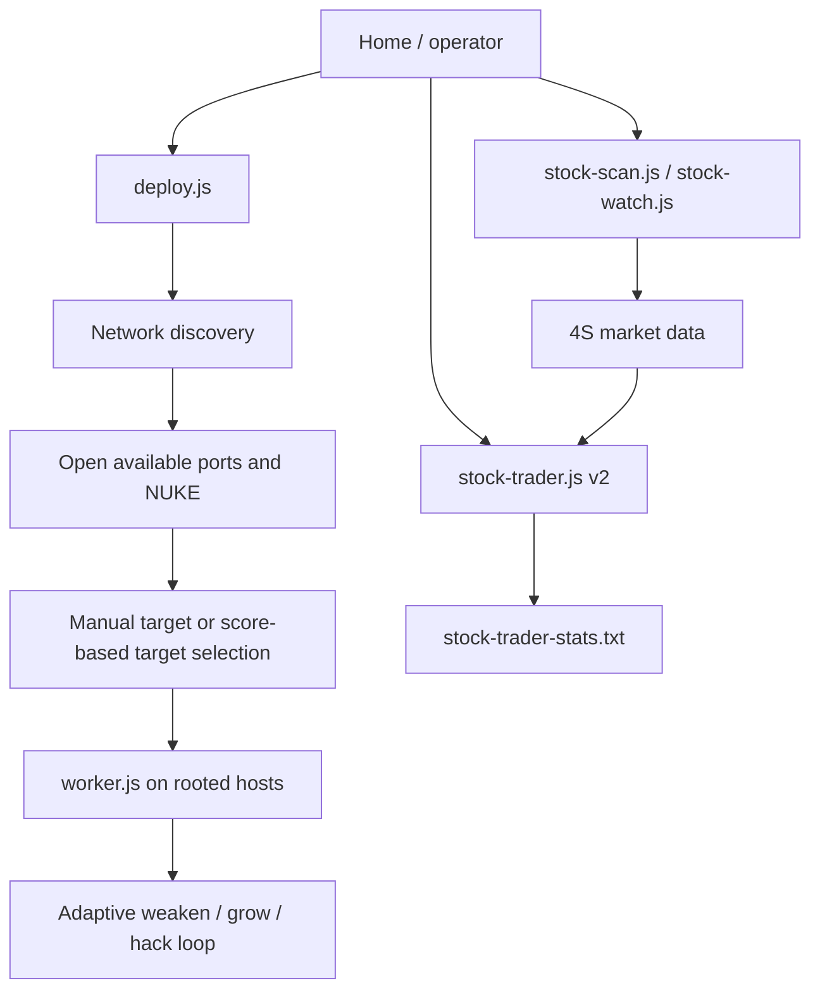

# Bitburner Automation Architecture

> Evidence-based description of the scripts currently present in this
> repository. Runtime values are drawn from the latest verified checkpoint:
> Session 17 in `# Bitburner 100% Playbook.md`.

------------------------------------------------------------------------

# Current System

The project uses two independent income systems: a distributed hacking network
and a long-only stock trader. `deploy.js` is an on-demand recovery and
orchestration command, not a permanently running service. It discovers and
roots the public network, selects a target, and starts `worker.js` on each
eligible host. `stock-trader.js` independently trades 4S forecast signals from
Home. Manual play can therefore focus on training, factions, achievements, or
feature discovery while both systems operate.

At the Session 17 checkpoint, the documented hacking deployment was 43 worker
hosts, 1,338 worker threads, and target `4sigma`. The values are a historical
verified checkpoint, not a live game-state query.

------------------------------------------------------------------------

# Hacking Automation

## Discovery, rooting, and deployment

`Scripts/deploy.js` performs a breadth-first scan from `home`. For each
discovered non-Home server, it invokes every port opener currently available
on Home (`BruteSSH.exe`, `FTPCrack.exe`, `relaySMTP.exe`, `HTTPWorm.exe`, and
`SQLInject.exe`) and calls `nuke()` only when it has opened enough ports.

The command accepts an optional target. Without one, it chooses a rooted,
hackable money server by sorting candidates on maximum money × hack chance ÷
hack time. It then stops only its prior `worker.js` instance on each rooted
non-Home host, copies the worker, calculates free RAM after other scripts, and
starts as many worker threads as fit. It reports discovery, root, host, thread,
and target totals to the terminal.

`Scripts/scan.js` is different: it reports only the neighbours of the current
host, including required level/ports, root and backdoor status, RAM, and money.
`Scripts/route.js` performs a breadth-first route search from Home and prints
the connection commands plus a final `backdoor` reminder.

## Worker behaviour and recovery

`Scripts/worker.js` is a simple adaptive loop, not a timed HWGW batch system.
It weakens when security is more than five above minimum, grows when money is
below 75% of maximum, and otherwise hacks. The loop is the normal production
workload started by `deploy.js`.

`Scripts/drain.js` and `Scripts/recover.js` are intentionally separate
one-off tools. The first drains a rooted money server while keeping security
within the same five-point buffer; the second restores a rooted money server to
maximum money while weakening as needed. They isolate achievement work from the
production worker loop. `Scripts/hack.js`, `grow.js`, and `weaken.js` are
single-action infinite loops; `Scripts/analyzeServers.js` prints suitability
metrics for its hard-coded five-server list; and `Scripts/list-augs.js` prints
owned augmentations from reset information.

## Operational limits

- `deploy.js` does not deploy to Home and does not install backdoors.
- It uses all available RAM on eligible remote hosts after preserving RAM used
  by unrelated scripts; it does not reserve capacity or schedule batches.
- Target selection is a heuristic based on money, chance, and hack time;
  it does not use the Formulas API despite Formulas.exe being documented as
  acquired in Run 6.
- No purchased-server automation is currently exercised in the latest verified
  checkpoint because the documented count is 0 / 25.

------------------------------------------------------------------------

# Stock-Market Automation

`Scripts/stock-trader.js` is the production trader. It assumes stock and 4S
APIs are already available; it does not validate those prerequisites itself.
Every five seconds it evaluates all symbols and makes long positions only:

| Control | Implemented value |
|---------|-------------------|
| Buy signal | Forecast at or above 65% |
| Exit signal | Forecast below 50% |
| Cash reserve | $100b |
| Position sizing | At most 10% of cash above the reserve per new position |
| Minimum trade value | $1b |
| Commission used for P/L | $100,000 per side |
| Position direction | Long only |

The trader will not open a second long while one is held. On a sale it records
realised profit, closed-trade count, and win/loss count in
`stock-trader-stats.txt`; it also displays realised, unrealised, total P/L,
positions, and cash. That stats file is generated at runtime and is not stored
in this repository. Session 15 recorded that its persisted realised P/L could
be stale relative to live logs; Session 17 leaves investigation of that issue
open. The audit does not treat the stored statistic as a verified performance
total.

`Scripts/stock-scan.js` is a manual market snapshot. It can label potential
shorts, but it does not trade. `Scripts/stock-watch.js` samples 4S forecasts
every five seconds, retains 24 in-memory samples, and highlights persistent
long/short candidates (75% of samples at or beyond 60%/40%). It is explicitly
deprecated for normal trading and retained for diagnostics and tuning.

------------------------------------------------------------------------

# Infrastructure and Operating Procedure

The latest verified Session 17 state records approximately 4.10 TB Home RAM,
8 / 8 Home CPU cores, 30 Hacknet nodes, 0 / 25 purchased servers, and 69 / 70
rooted public servers. Home upgrades and Hacknet growth are infrastructure
investments; neither is directly managed by a repository script.

After an augmentation installation, the documented recovery sequence is:

1. Reacquire or create the required port-opening programs.
2. Run `deploy.js` to scan, root, choose a target, copy workers, and restore
   distributed income.
3. Use `route.js` to recover faction-server access and backdoors as needed.
4. Resume market diagnostics or `stock-trader.js` once market access is
   available and the desired trading state is confirmed.

The documented Run 6 recovery reached 69 / 70 rooted servers and 1,338 worker
threads after restoration of the five-port toolkit. This is evidence of the
workflow working at that checkpoint, not a guarantee that each script will
operate unchanged in every future game version or save.

------------------------------------------------------------------------

# Decision Status

| Status | Decision | Evidence and reconsideration point |
|--------|----------|------------------------------------|
| Implemented | Use `deploy.js` plus generic workers for unattended hacking. | Sessions 15–17 and current source; reconsider when batch scheduling offers a verified benefit. |
| Implemented | Make `stock-trader.js` v2 the normal trader. | Session 15 and current source; `stock-watch.js` remains diagnostic. |
| Implemented | Maintain a $100b trader reserve and long-only 4S rules. | Current `stock-trader.js`; revisit only with measured strategy evidence. |
| Planned | Reach Hacking 2,500, then reassess `fl1ght.exe` / Daedalus. | Session 17; not yet complete. |
| Deferred | Advanced HWGW batching. | Playbook and Research Library; no batch implementation exists. |
| Deferred | Dark Net depth, cache, file, and Stasis Link work. | Playbook objectives; no Dark Net scripts are present in this repository. |
| Deferred | Shadows of Anarchy infiltration. | Session 15; deliberately postponed. |
| Superseded | Use `stock-watch.js` for normal trading. | Replaced by `stock-trader.js` v2 in Session 15. |

------------------------------------------------------------------------

# Evidence Boundaries

This document describes repository contents and recorded checkpoints. It does
not assert that absent historical scripts (`dnet-worker.js`, `dnet-stasis.js`,
`weaken-only.js`, and `n00dles.js`) are available or operational. Live game
state, market positions, and runtime statistics require in-game verification.
