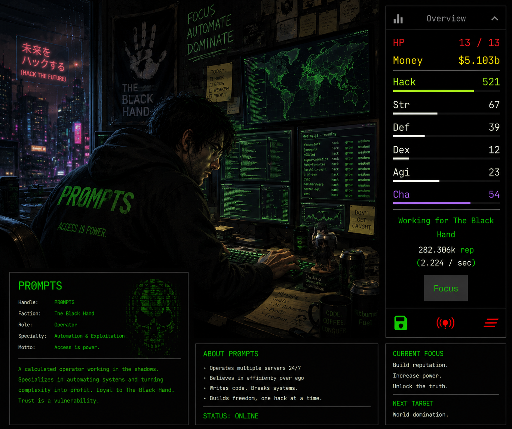

# Bitburner 100% Playbook

A living playbook documenting my journey to achieve 100% completion in **Bitburner**.

The goal of this project is to earn every achievement while building a practical, well-documented strategy that others can follow or adapt for their own playthroughs. Rather than simply recording what happened, this playbook captures the reasoning behind key decisions, verified game mechanics, lessons learned, and optimizations discovered along the way.

## Objectives

- Complete all Bitburner achievements.
- Follow a natural progression before optimizing later playthroughs.
- Verify mechanics using the official documentation and source code where appropriate.
- Record scripts, strategies, milestones, and important discoveries.
- Maintain a versioned, evolving reference throughout the entire playthrough.

## Repository Contents

- [# Bitburner 100% Playbook.md](%23%20Bitburner%20100%25%20Playbook.md) – The canonical playbook, run history, objectives, achievements, and decisions.
- [ARCHITECTURE.md](ARCHITECTURE.md) – The current automation architecture and evidence-backed operating model.
- [Research Library.md](Research%20Library.md) – Sources, verified findings, and research priorities.
- [CHARACTER-EVOLUTION.md](CHARACTER-EVOLUTION.md) – PR0MPTS' approved visual history and continuity rules.
- `Scripts/` – Netscript automation and diagnostic tools.

## Run 6 — Automation Infrastructure

PR0MPTS uses three production systems and a separate experimental Darknet reconnaissance subsystem that can operate alongside manual training, faction work, and achievement hunting:

1. **Distributed hacking network:** `deploy.js` discovers and roots public servers, selects a money target, and deploys `worker.js` to run adaptive weaken/grow/hack loops.
2. **Autonomous stock trading:** `stock-trader.js` independently manages long-only trades using 4S market data. `stock-watch.js` and `stock-scan.js` remain diagnostic tools.
3. **Purchased-server XP datacenter:** Dedicated purchased servers run `xp-worker.js` to gain hacking experience through repeated weakening, without replacing the normal money-network workers.
4. **Operation Darknet (experimental):** `darknet-gateway.js` probes from `darkweb`; `darknet-controller.js` v2.1 on `home` reconciles reports and preserves dynamic network history. Authentication and deep traversal are not production features.

### Operation Darknet — verified reconnaissance checkpoint

The gateway scans every 30 seconds, copies `darknet-gateway-report.txt` to `home`, and the controller maintains `darknet-state-v2.txt` and `darknet-stats-v2.txt`. Its 90-second freshness threshold distinguishes recent gateway observations from stale reports. A recorded test saw **8 known servers, 8 active links and 7 gateway neighbours**. A separate ZeroLogon test authenticated with an empty password (`200`), but the controller's authentication count remains **0**: automated authentication and persistent sessions are future work.

The Darknet toolkit includes `darknet-scout.js`, `darknet-gateway.js`, `darknet-controller.js`, `darknet-auth.js`, and `darknet-zerologon.js`. The latter two are experimental; confirm script files are committed before assuming repository availability. For architecture, safe recovery and evidence boundaries see [ARCHITECTURE.md](ARCHITECTURE.md) and [Research Library.md](Research%20Library.md).

### Verified datacenter milestone

| Measure | Verified observation |
|---|---|
| Purchased servers | 25 / 25 |
| RAM per server | 1,048,576 GB (approximately 1.05 PB) |
| Combined server RAM | 26,214,400 GB (approximately 26.21 PB) |
| Active XP worker processes | 25 |
| Dedicated XP threads | 25,000 |
| RAM used across purchased servers | Approximately 47.50 TB |
| Infrastructure purchase cost | Approximately $1.442 trillion |
| Hacking level at monitoring checkpoint | 2,073 |

These are **observed Run 6 values**, not universal limits for every game version or BitNode. The XP workers are confirmed running, and faster hacking progression has been observed; precise XP-per-second performance and scaling efficiency remain to be measured.

### Datacenter script reference

| Script | Role |
|---|---|
| `datacenter-check.js` | Inspect purchased-server limits, costs, RAM, and utilisation. |
| `datacenter-build.js` | Provision purchased servers at the available maximum RAM. |
| `xp-worker.js` | Continuously run `weaken()` on a rooted target to earn hacking XP. |
| `xp-deploy.js` | Distribute XP workers across the purchased-server fleet while checking existing processes. |
| `xp-stats.js` | Report XP worker processes, thread totals, RAM usage, and hacking XP. |
| `deploy.js` | Manage the conventional hacking network; purchased servers are excluded from its deployment fleet in the updated version. |

The money network, stock trader, and XP datacenter should be managed independently. Deployment and scaling must preserve unrelated scripts, especially live trading processes. Avoid allocating all available RAM or increasing thread counts without checking XP performance and game responsiveness.

See [ARCHITECTURE.md](ARCHITECTURE.md) for deployment, separation of responsibilities, and recovery procedures. See [Research Library.md](Research%20Library.md) for the underlying evidence, Bitburner 3.0 Cloud API findings, and open optimisation questions.

**Run status:** This is an infrastructure milestone within Run 6, **not** an augmentation installation or run reset.

## Philosophy

This repository is intended to grow organically throughout the playthrough. Information is added as it is learned and verified, making this both a personal project log and a practical reference for anyone interested in completing Bitburner.

## PR0MPTS Character Evolution

PR0MPTS' visual history is maintained in
[CHARACTER-EVOLUTION.md](CHARACTER-EVOLUTION.md). **Run 6 — Quadrillionaire**
is the current canonical appearance.

### Session 1 — Humble Beginnings

PR0MPTS begins his journey with basic equipment and limited resources.

### Early Career — Black Hand Operative

At Hacking Level 521, PR0MPTS is faction-reputation grinding and establishing
early automation. The exact run number is unconfirmed.

### Run 4 — Veteran Operator

An experienced hacker rebuilding his automation empire after previous runs.

### Run 5 — Criminal Financier

The homicide crime spree, BitRunners affiliation, automated stock trading, and
wealth exceeding $1.5 trillion define this stage.

### Run 6 — Quadrillionaire

The current canonical appearance: wealth exceeding $100 quadrillion, extensive
automation, and an extraordinary luxury high-rise environment.
