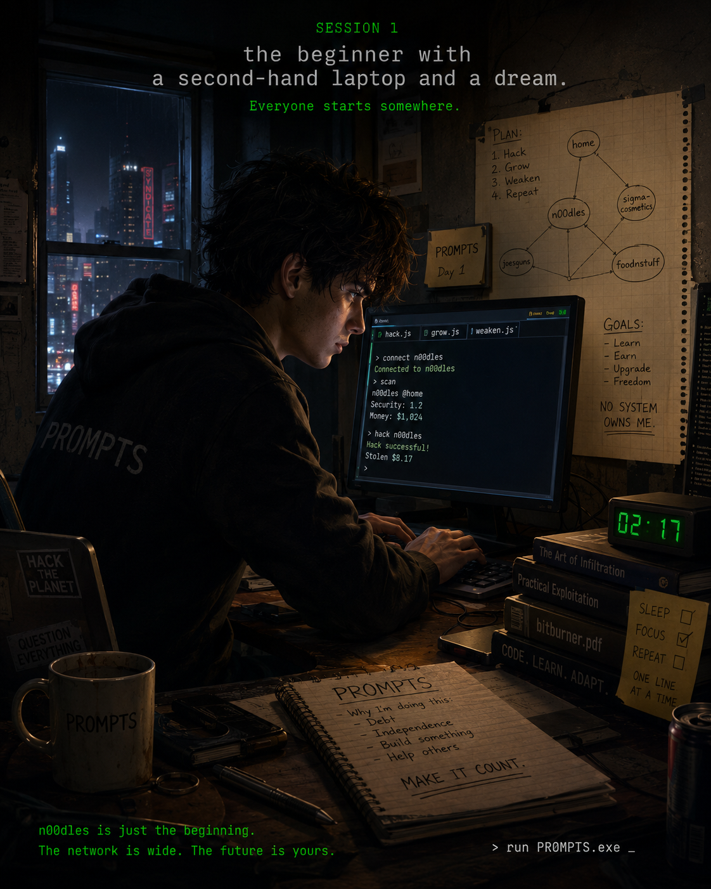
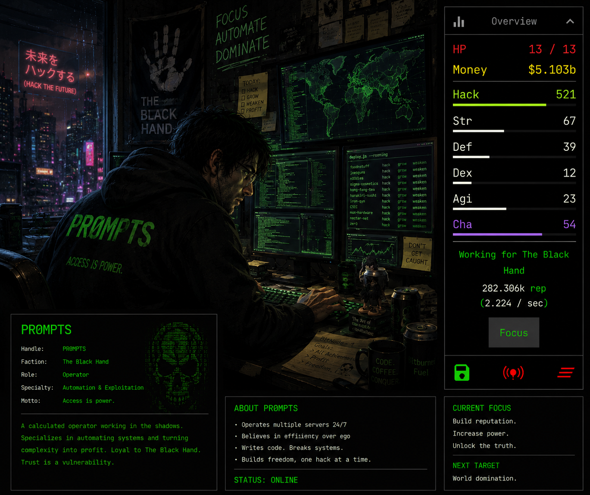
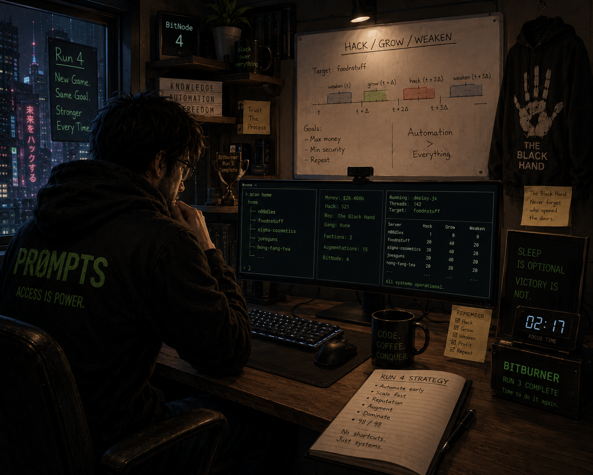
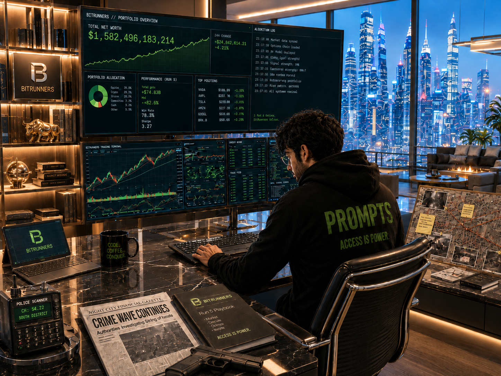

# Bitburner 100% Playbook

A living playbook documenting my journey to achieve 100% completion in **Bitburner**.

The goal of this project is to earn every achievement while building a practical, well-documented strategy that others can follow or adapt for their own playthroughs. Rather than simply recording what happened, this playbook captures the reasoning behind key decisions, verified game mechanics, lessons learned, and optimizations discovered along the way.

## Objectives

- Complete all Bitburner achievements.
- Follow a natural progression before optimizing later playthroughs.
- Verify mechanics using the official documentation and source code where appropriate.
- Record scripts, strategies, milestones, and important discoveries.
- Maintain a versioned, evolving reference throughout the entire playthrough.

## Repository Contents

- [# Bitburner 100% Playbook.md](%23%20Bitburner%20100%25%20Playbook.md) – The canonical playbook, run history, objectives, achievements, and decisions.
- [ARCHITECTURE.md](ARCHITECTURE.md) – The current automation architecture and evidence-backed operating model.
- [Research Library.md](Research%20Library.md) – Sources, verified findings, and research priorities.
- [CHARACTER-EVOLUTION.md](CHARACTER-EVOLUTION.md) – PR0MPTS' approved visual history and continuity rules.
- `Scripts/` – Netscript automation and diagnostic tools.

## Philosophy

This repository is intended to grow organically throughout the playthrough. Information is added as it is learned and verified, making this both a personal project log and a practical reference for anyone interested in completing Bitburner.

## PR0MPTS Character Evolution

PR0MPTS' visual history is maintained in
[CHARACTER-EVOLUTION.md](CHARACTER-EVOLUTION.md). **Run 6 — Quadrillionaire**
is the current canonical appearance.

### Session 1 — Humble Beginnings

PR0MPTS begins his journey with basic equipment and limited resources.

### Early Career — Black Hand Operative

At Hacking Level 521, PR0MPTS is faction-reputation grinding and establishing
early automation. The exact run number is unconfirmed.

### Run 4 — Veteran Operator

An experienced hacker rebuilding his automation empire after previous runs.

### Run 5 — Criminal Financier

The homicide crime spree, BitRunners affiliation, automated stock trading, and
wealth exceeding $1.5 trillion define this stage.

### Run 6 — Quadrillionaire

The current canonical appearance: wealth exceeding $100 quadrillion, extensive
automation, and an extraordinary luxury high-rise environment.
